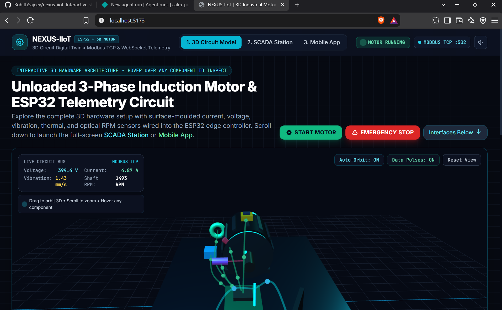
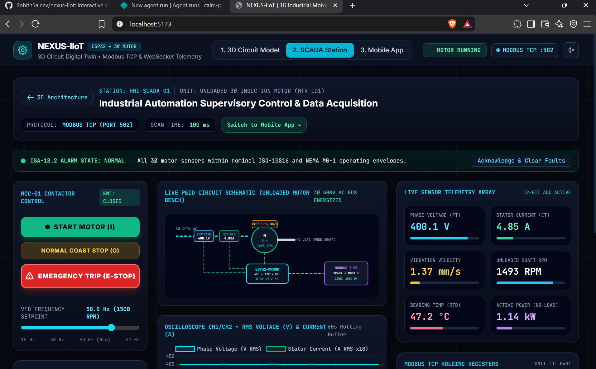
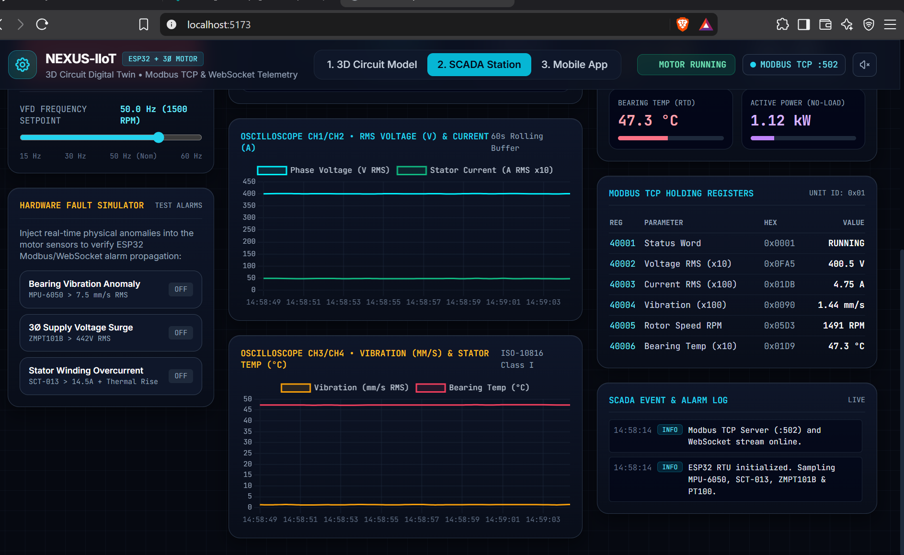
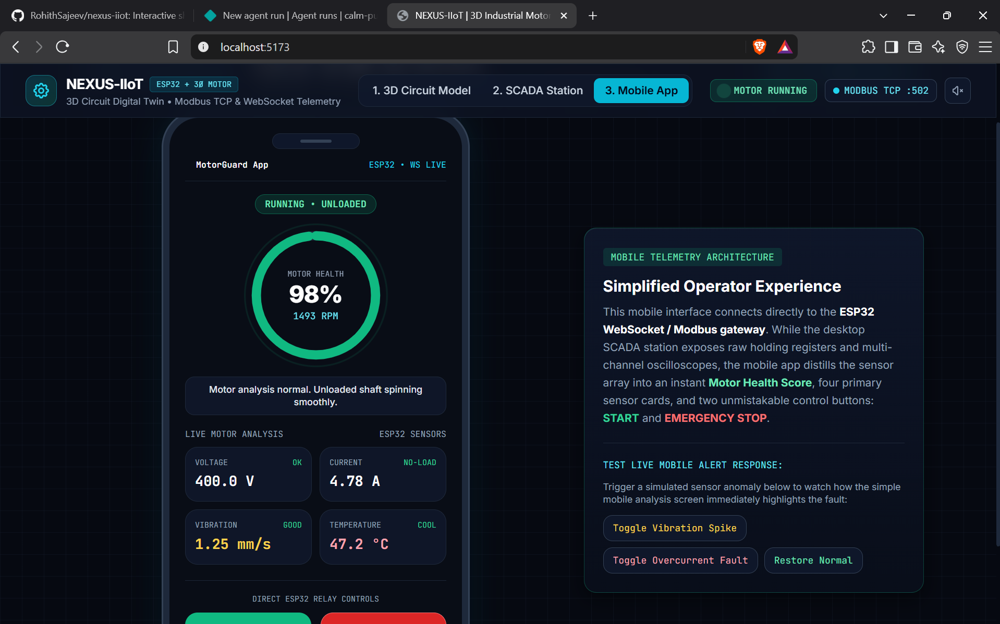

# NEXUS-IIoT

**A 3D digital twin, SCADA station and mobile operator app for an IoT-based predictive maintenance and remote protection system for induction motors.**

**Live demo:** [https://nexus-iiot3dsimulation.netlify.app](https://nexus-iiot3dsimulation.netlify.app)

NEXUS-IIoT is an interactive showcase of the final-year project *IoT and SCADA-Based Predictive Maintenance and Remote Protection System for Induction Motors*. It shows how the finished system will look and behave: an ESP32 edge controller reads five sensors on a three-phase induction motor and streams the data to an industrial SCADA console and a mobile operator app.

> **Note:** this site is a simulation. The telemetry is produced by an in-browser physics engine that models the motor, the sensors and the ESP32 data path. It is not connected to physical hardware.

## The Three Views

### 1. 3D Circuit Model

A real-time WebGL scene of the complete test bench, built with Three.js. Every component is constructed procedurally in JavaScript, so no external 3D model files are needed and the scene loads instantly.

- An unloaded three-phase squirrel-cage induction motor with cooling fins, end bells and a visible spinning rotor shaft
- Five sensor assemblies: MEMS vibration accelerometer, split-core current transformer, AC voltage sensor, RTD temperature probe and optical tachometer
- An ESP32 edge controller, a SCADA workstation and a smartphone node
- Spline-based wiring with animated data pulses that show signals flowing from the sensors to the ESP32, then out over Modbus TCP and WebSockets
- Orbit and zoom controls, plus hover inspection: a raycaster identifies each component and shows what it does, its GPIO pin, its Modbus register and its live reading

### 2. SCADA Station

A control-room style dashboard.

- Motor Control Center rack with Start, Normal Coast Stop and Emergency Trip
- VFD frequency slider from 15 to 60 Hz
- Live P&ID schematic with animated power lines
- Four rolling 60-second oscilloscope traces for voltage, current, vibration and bearing temperature (Chart.js)
- KPI cards, a Modbus TCP holding-register table (40001 to 40006) showing raw 16-bit hexadecimal values, and an alarm log following ISA-18.2 conventions
- A hardware fault simulator for bearing vibration anomaly, three-phase voltage surge and stator overcurrent

### 3. Mobile App (MotorGuard)

A simplified operator interface inside a smartphone frame, designed for quick floor diagnostics.

- Animated motor health gauge that shifts between green, amber and red
- Plain-language diagnostic verdict
- Live voltage, current, vibration and temperature cards with status badges
- Start and Emergency Stop controls

## Shared Simulation Engine

All three views read from and write to a single state object that acts as the shared memory of the ESP32.

- A physics loop calculates synchronous speed from the VFD setpoint and applies a small no-load slip, so the unloaded shaft settles near 1,492 RPM at 50 Hz
- Starting, stopping and tripping the motor produce acceleration, coast-down and emergency braking, and the resulting angular velocity drives the 3D rotor
- Injected faults change the sensor equations, increase the 3D motor jitter, recalculate the health score and log timestamped alarms
- Because the state is shared, pressing Emergency Stop on the mobile app immediately stops the 3D shaft and trips the contactor on the SCADA console
- Navigation uses a single-page view router, so switching views does not reset the simulation history

An optional Web Audio synthesizer produces a motor hum whose pitch follows the actual RPM.

## Screenshots

**3D Circuit Model**



**SCADA Station**



**SCADA Telemetry and Modbus Registers**



**Mobile App**



## Tech Stack

| Area | Technology |
|---|---|
| 3D rendering | Three.js r128 (WebGL), raycaster, custom orbit camera |
| Charts | Chart.js |
| Styling | Tailwind CSS, Inter and JetBrains Mono fonts |
| Audio | Web Audio API |
| Schematics | Inline SVG |
| Logic | Plain JavaScript in a single HTML file |
| Hosting | Netlify |

## Sensors Modelled

| Measurement | Sensor |
|---|---|
| Vibration | MPU-6050 |
| Stator current | SCT-013 current transformer |
| Phase voltage | ZMPT101B |
| Bearing temperature | PT100 RTD |
| Shaft speed | Optical tachometer |

## Running Locally

The site is a single `index.html` file. Open it in a browser, or serve it locally:

```bash
git clone https://github.com/RohithSajeev/nexus-iiot.git
cd nexus-iiot
npx vite
```

## Author

**Rohith Sajeev**
Final-year Electrical and Electronics Engineering student, Vimal Jyothi Engineering College, Kannur
[LinkedIn](https://linkedin.com/in/rohith-sajeev-5167793a4) · rohithsajeev1010@gmail.com
